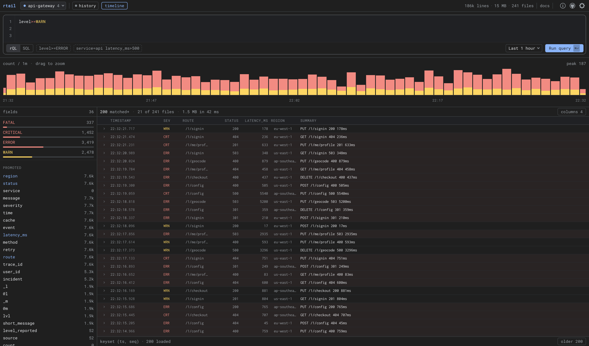

# `rtail(1)`

## Terminal output to the browser in seconds, using UNIX pipes.

> **v2 — release candidate.** v2 is a rewrite: a durable, searchable log store
> backed by Parquet and SQL. The server is a single Go binary with the webapp
> embedded, and the npm package carries only the client pipe.
>
> The `cmd | rtail` wire format is frozen and always will be — the client you
> already have installed works against a v2 server unchanged.
>
> **Where it is:** everything described below is built and tested — storage,
> search, compaction, the explorer, the four ingest protocols, authentication,
> TLS, and a release pipeline that publishes four tarballs, six npm packages
> and a container image per tag. `2.0.0-rc.2` is the current release; until
> `2.0.0` is tagged, reaching it takes `RTAIL_PRERELEASE=1` — see below.

`rtail` is a command line utility that grabs every line in `stdin` and broadcasts it over **UDP**. That's it. Nothing fancy. Nothing complicated. Tail log files, app output, or whatever you wish, using `rtail` broadcasting to an `rtail-server` – See multiple streams in the browser, in realtime.

## Running the server

The server ships as a container image — this is the recommended way to run it.

    $ docker run -d --name rtail -p 8888:8888 -p 9999:9999/udp ghcr.io/kilianc/rtail

Open <http://localhost:8888> and start piping. There is a
[`docker-compose.yml`](docker-compose.yml) if you prefer:

    $ docker compose up -d

Options are flags, or `RTAIL_*` environment variables:

    $ docker run -d -p 8080:8080 -p 9999:9999/udp \
        -e RTAIL_WEB_PORT=8080 ghcr.io/kilianc/rtail

    $ docker run -d -p 8888:8888 -p 9999:9999/udp \
        ghcr.io/kilianc/rtail --backlog 500

The image is memory-only until you give it somewhere to write. `/data` is
there for that, owned by the user the server runs as:

    $ docker run -d -p 8888:8888 -p 9999:9999/udp \
        -e RTAIL_DATA=/data -v rtail-data:/data ghcr.io/kilianc/rtail

The image binds `0.0.0.0` inside the container, so **the published ports are
reachable from your whole network**. It has no authentication — keep it on a
trusted network, or put a reverse proxy in front of it.

## Releases

Tagged releases carry a binary for each platform and a container image.

    $ docker run -p 8888:8888 -p 9999:9999/udp ghcr.io/kilianc/rtail

Or take the binary for your platform from the
[releases page](https://github.com/kilianc/rtail/releases) — `linux_amd64`,
`linux_arm64`, `darwin_amd64`, `darwin_arm64`, with a `checksums.txt` beside
them. There is no Windows build: DuckDB is cgo and nobody has asked.

The binary is not static, because DuckDB is cgo. Linux builds are linked in
Debian bookworm, so they need glibc 2.36 or newer; the container image is the
answer on anything older. Every binary is started and asked for `/healthz`
before it is published, so a release that cannot run does not become one.

## Installing the client

The client is a UNIX pipe and belongs on the host whose output you are tailing,
not in the container. It is a single Go binary, about 2.6 MB, with no runtime
of any kind:

    # the short way
    $ curl -fsSL https://raw.githubusercontent.com/kilianc/rtail/main/install.sh | sh

    # or take the tarball yourself — it is what the line above downloads
    $ tar -xzf rtail_2.0.0-rc.2_darwin_arm64.tar.gz
    $ sudo mv rtail_2.0.0-rc.2_darwin_arm64/rtail /usr/local/bin

    # or, if you have Go
    $ go install github.com/kilianc/rtail/v2/cmd/rtail@latest

    # or, if you are already standing in a project
    $ npm install -g rtail@next

**While 2.0 is a release candidate, two of those four need telling.** GitHub's
"latest release" skips prereleases, and npm's `latest` tag still points at
`0.2.1` — the v1 Node client — so the plain forms quietly hand you something
older:

    $ curl -fsSL https://raw.githubusercontent.com/kilianc/rtail/main/install.sh | RTAIL_PRERELEASE=1 sh
    $ npm install -g rtail@next

`go install …@latest` needs nothing: there is no `v2` release tag yet, so Go
resolves it to the newest prerelease. Taking the tarball by name needs nothing
either. When `2.0.0` is tagged, all four plain forms are correct.

[`install.sh`](install.sh) detects your platform, checks the download against
the release's own `checksums.txt` and refuses to continue on a mismatch,
installs one binary into `/usr/local/bin` — or `~/.local/bin` if that is not
writable, because a script piped from the internet should not be the thing
that asks for your password — and touches nothing else. It never calls `sudo`
and never edits your shell profile. `RTAIL_VERSION`, `RTAIL_INSTALL_DIR` and
`RTAIL_SERVER=1` override the obvious things. It is a hundred lines of POSIX
sh; `curl -fsSL https://raw.githubusercontent.com/kilianc/rtail/main/install.sh | less` reads the whole of it,
and doing that before you pipe anything into `sh` is a good habit generally.

The npm route is a convenience, not a dependency: the package holds a short
launcher and one optional dependency per platform, each carrying a prebuilt
binary and declaring the `os` and `cpu` it is for. npm downloads the one that
matches and skips the rest. There is no postinstall script and nothing is
fetched at install time, so it works behind a proxy and under
`--ignore-scripts`. The launcher needs Node 20 or newer; the other two routes
need nothing.

Windows is published to npm and not as a tarball — the client cross-compiles
anywhere, the server does not.

## The explorer

*A spike of upstream timeouts, twenty minutes back: `level>=WARN` on the `api`
stream, with `service`, `latency_ms` and `region` promoted to columns.*

**One filter drives everything.** Type it and the live tail narrows — the
server compiles the same rQL to a predicate over the ingest stream. Switch to
history and the same query runs against Parquet. Same semantics either way,
because there is one parser behind both.

**The histogram is the navigation.** Counts over time stacked by severity; drag
across it to zoom the range.

**Most queries are built by clicking.** Expand any event and every value
carries "filter to this" and "exclude this"; the command bar updates to match,
so whatever you built by pointing is something you could have typed. The field
sidebar shows the top values of every field *within the current results*, which
answers "what is even in here" before you know what to search for.

**Completion is real.** It comes from the catalog's key inventory — every field
that has actually appeared, with its type and how often — not from a guess at
what a log line might contain.

**Every view is a link.** Stream, filter, time range, promoted columns, and
whether the timeline is open — all of it lives in the URL, so the screenshot
above is a URL somebody could send you.

**Any field can become a column.** The ⊞ beside a field in the sidebar pulls it
out of the summary into a column of its own, and the × on the header puts it
back.

**The query pane holds everything that acts on the query** — the language
switch, the examples, the time range and Run — inside its own border, because
they belong to the query rather than to the page.

Keyboard: `/` or `⌘K` focuses the editor, `⌘⏎` runs it (plain `⏎` is a
newline — it is an editor), `j`/`k` move between events, `⎋` collapses
everything.

## Getting logs in

Four ways, and every one of them lands in the same envelope — a record is
indistinguishable once stored, whichever door it came through.

**UNIX pipes**, the original, frozen forever:

    $ node server.js 2>&1 | rtail --id api.example.com

**HTTP**, for anything that would mind losing a line. UDP is at-most-once and
capped at one datagram; this acknowledges, so a 200 means every line is in the
write-ahead log:

    $ curl -XPOST 'localhost:8888/v1/ingest?stream=api' --data-binary @- <<'JSON'
    {"level":"error","msg":"upstream timeout","service":"api","latency_ms":30004}
    a plain line works too
    JSON

Anything else may arrive after part of the batch was already stored — a store
that fails halfway through is a 503, a body past `--max-body-mb` a 413 — so
every response says how many lines it `accepted`, and those first lines are
durable. Resume after them rather than replaying the batch.

Newline-delimited JSON or plain text — the content type is not consulted,
because the normalizer already decides per line what it is looking at. `gzip`
and `zstd` bodies are decoded.

**OpenTelemetry**, protobuf or JSON, at `/v1/logs`. Point any collector at it
with a config line and no code change:

    exporters:
      otlphttp:
        logs_endpoint: http://rtail:8888/v1/logs

`service.name` becomes the stream, log and resource attributes become fields,
and `trace_id`/`span_id` are promoted so correlation actually works.

**Syslog**, RFC5424 and RFC3164, UDP and TCP on the same port:

    $ rtail-server --data ./logs --syslog-port 5140

    # rsyslog.conf
    *.* @@rtail-host:5140;RSYSLOG_SyslogProtocol23Format

APP-NAME becomes the stream, the priority becomes a real severity — so
`level>=ERROR` works on syslog without anyone writing a parser — and RFC5424
structured data is promoted to fields.

Anything that can write NDJSON to an HTTP endpoint works without a plugin:

    # vector.toml
    [sinks.rtail]
    type = "http"
    inputs = ["my_source"]
    uri = "http://rtail:8888/v1/ingest?stream=vector"
    encoding.codec = "json"
    framing.method = "newline_delimited"

    # fluent-bit.conf
    [OUTPUT]
        Name   http
        Match  *
        Host   rtail
        Port   8888
        URI    /v1/ingest?stream=fluentbit
        Format json_lines

## Rationale

Whether you deploy your code on remote servers using multiple environments or simply have multiple projects, **you must `ssh` to each machine running your code, in order to monitor the logs in realtime**.

There are many log aggregation tools out there, but few of them are realtime. **Most other tools require you to change your application source code to support their logging protocol/transport**.

`rtail` is meant to be a replacement of [logio](https://github.com/NarrativeScience/Log.io/commits/master), which isn't actively maintained anymore, doesn't support node v0.12., and uses *TCP. (TCP requires strict client / server handshaking, is resource-hungry, and very difficult to scale.)*

**The `rtail` approach is very simple:**
* pipe something into `rtail` using [UNIX I/O redirection](http://www.westwind.com/reference/os-x/commandline/pipes.html) [[2]](http://www.codecoffee.com/tipsforlinux/articles2/042.html)
* broadcast every line using UDP
* `rtail-server`, **if listening**, will dispatch the stream into your browser, using [server-sent events](https://developer.mozilla.org/en-US/docs/Web/API/Server-sent_events).

`rtail` is a realtime debugging and monitoring tool, which can display multiple aggregate streams via a modern web interface. **With `--data` it now keeps them too, and lets you search them with SQL** — see [Storage](#storage) and [Search](#search) below.

## Storage

    $ rtail-server --data ./logs

Point `--data` at a directory and every line is written to Parquet. Without it,
rtail is what it always was: an in-memory ring, nothing on disk, nothing to
clean up.

**There is no schema to define.** The envelope — timestamp, stream, level,
message, host, sequence, and the original line — is always there. Everything
else is whatever your logs happened to contain: each root-level JSON key
becomes its own typed column, and nested objects are kept as JSON you can
path into. Two files written a week apart with completely different keys
reconcile by name at read time.

**Your logs are just files.** The layout is plain and browsable:

    logs/
      catalog.sqlite
      wal/
      streams/api.example.com/2026/08/11/L0-…parquet

which means any tool reads them, with rtail uninstalled and nothing exported:

    $ duckdb -c "
        SELECT a_service, count(*)
        FROM read_parquet('logs/streams/**/*.parquet', union_by_name := true)
        WHERE level = 'ERROR' AND a_latency_ms > 500
        GROUP BY 1"

That is the point, and it is covered by a test rather than merely claimed.

**Durability.** Lines land in a write-ahead log before anything else, and are
batched into Parquet from there. The WAL is fsynced every 100ms, so an
unclean shutdown costs at most that; a clean one costs nothing. Recovery
replays whatever the previous process did not finish, and is idempotent —
crashing midway through a flush and restarting produces the same files, not
duplicates.

**Compaction.** A flush every thirty seconds per stream is thousands of tiny
files a day, each with a footer to open. A background pass merges them:

| level | holds | sorted by |
|---|---|---|
| L0 | one flush | `seq` — the order it arrived in |
| L1 | an hour | `ts` |
| L2 | a day | `(level, ts)`, or `--cluster-by` |

Sort order is the point, not the file count. Sorting by time makes range
pruning exact at row-group granularity rather than merely likely, and a
low-cardinality leading column turns `level>=ERROR` over a day into a
row-group skip instead of a scan. Compaction is also where a messy population
of schemas becomes one clean union — types that disagreed get widened,
always-null columns disappear.

In practice six flushes of a small stream merge from 24KB to 5KB.

A merge either publishes its output and retires its inputs, or changes
nothing. Retired files stay on disk for a grace period, so a query that
started before the merge still has its files. `--compact-interval 0` turns the
whole thing off.

**Retention** is per-server, and all of it happens during compaction:

    $ rtail-server --data ./logs \
        --retention 30d \
        --retention-raw 7d \
        --downsample-after 14d --downsample-level WARN

`--retention` deletes whole files once their newest record is past the
horizon; a file straddling the boundary survives until all of it has expired,
because rewriting a file to drop a few rows costs far more than keeping them.
`--retention-raw` drops the original line while keeping every promoted column,
which roughly halves the footprint — the cost is that keys which were never
promoted stop being queryable, since `raw` was their fallback.
`--downsample-after` discards anything below `--downsample-level` once it is
old enough.

Durations take `d` and `w` as well as Go's own units, because `--retention
720h` is nobody's idea of clear.

## Search

Two ways in, sharing one set of semantics.

**The filter bar** — terse, and what most searching looks like:

    level>=ERROR service=api "connection timeout"
    -path:/health AND (region=us-east-1 OR region=us-west-2)
    latency_ms>500 req.path:~"^/v1/"
    trace_id=*

`k=v` is equality, `k:v` a case-insensitive substring, `k:~re` a regular
expression, `k>n` a comparison, `k=*` "the key exists", `k=null` "it does not".
A bare word is full-text across the message and the original line. Terms are
ANDed unless you write `OR`; `-` and `NOT` negate; parentheses group.

`level` compares by **severity, not alphabetically** — `level>=ERROR` matches
FATAL too, which is what you meant. Quoting a value suppresses type coercion,
so `status=200` is the number and `status="200"` is the string.

**Raw SQL**, for everything else:

    $ curl -XPOST localhost:8888/v1/sql --data-binary @- <<'JSON'
    {
      "sql": "SELECT a_service, count(*) n, quantile_cont(a_latency_ms, 0.95) p95 FROM logs WHERE level = 'ERROR' GROUP BY 1 ORDER BY n DESC",
      "from": "-6h"
    }
    JSON

The query is one line because JSON strings cannot hold a raw newline; write
`\n` if you want the SQL to keep its shape.

`logs` is a view over the pruned files. The query runs read-only in a DuckDB
sandbox that can see nothing but your data directory.

**The time range is the partition pruner**, not decoration. It is always
applied — a query without one gets the last 24 hours injected — and every
response reports the window it used along with how many files and rows the
query implied reading, so a slow search can explain itself.

## Examples

In your app init script:

    $ node server.js 2>&1 | rtail --id "api.myproject.com"

    $ mycommand | rtail > server.log

    $ node server.js 2>&1 | rtail --mute

Supports JSON5 lines:

    $ while true; do echo [1, 2, 3, "hello"]; sleep 1; done | rtail
    $ echo { "foo": "bar" } | rtail
    $ echo { format: 'JSON5' } | rtail

Using log files (log rotate safe!):

    $ node server.js 2>&1 > log.txt
    $ tail -F log.txt | rtail

For fun and debugging:

    $ cat ~/myfile.txt | rtail
    $ echo "Server rebooted!" | rtail --id `hostname`

## Params

    $ rtail --help
    Usage: cmd | rtail [OPTIONS]

    Options:
      --host, -h     The server host                 [string] [default: "127.0.0.1"]
      --port, -p     The server port                        [number] [default: 9999]
      --id, --name   The log stream id                 [string] [default: (moniker)]
      --mute, -m     Don't pipe stdin with stdout                          [boolean]
      --tty          Keeps ansi colors                     [boolean] [default: true]
      --help         Show help                                             [boolean]
      --version, -v  Show version number                                   [boolean]

    Examples:
      server | rtail > server.log         localhost + file
      server | rtail --id api.domain.com  Name the log stream
      server | rtail --host example.com   Sends to example.com
      server | rtail --port 43567         Uses custom port
      server | rtail --mute               No stdout
      server | rtail --no-tty             Strips ansi colors

## `rtail-server(1)`

`rtail-server` receives all messages broadcast from every `rtail` client, displaying all incoming log streams in a realtime web view. **Under the hood it is a single Go binary with the webapp embedded, pushing every incoming UDP message to the browser over server-sent events.**

Everything is a flag, or the same name as an `RTAIL_*` environment variable.
The defaults are chosen so that `rtail-server` with no arguments is the v1
behaviour: both listeners on loopback, an in-memory ring, nothing on disk.

## Examples

Use default values:

    $ rtail-server

Use custom ports:

    $ rtail-server --web-port 8080 --udp-port 9090

Set debugging on:

    $ rtail-server --verbose

Open your browser and start tailing logs!

## Params

`rtail-server --help` prints the lot. Grouped by what they touch:

**Listening**

| flag | default | |
|---|---|---|
| `--web-host` | `127.0.0.1` | HTTP listen address |
| `--web-port` | `8888` | HTTP port |
| `--udp-host` | `127.0.0.1` | UDP listen address |
| `--udp-port` | `9999` | UDP port |
| `--syslog-host` | `--udp-host` | syslog listen address |
| `--syslog-port` | `0` | syslog on this port, UDP and TCP; `0` disables it |

**Storage** — see [Storage](#storage)

| flag | default | |
|---|---|---|
| `--data` | unset | directory for durable storage; unset is memory only |
| `--backlog` | `100` | lines of live history kept per stream |
| `--compact-interval` | `5m` | how often to compact; `0` disables it |
| `--cluster-by` | `level` | leading sort column for daily files; empty is time only |
| `--retention` | `0` | delete data older than this; `0` keeps it forever |
| `--retention-raw` | `0` | drop the original line after this, keeping the columns |
| `--downsample-after` | `0` | discard low-severity records older than this |
| `--downsample-level` | `WARN` | the lowest severity `--downsample-after` keeps |

**Ingest**

| flag | default | |
|---|---|---|
| `--ingest-stream` | `http` | stream for HTTP records that name none |
| `--max-body-mb` | `32` | largest accepted ingest request |

**Access** — see [Authentication](#authentication)

| flag | default | |
|---|---|---|
| `--auth-token` | unset | require this bearer token on the HTTP API and webapp |
| `--insecure` | off | allow a non-loopback address with no `--auth-token` |
| `--tls-cert`, `--tls-key` | unset | serve HTTPS; both or neither |

**Everything else**

| flag | default | |
|---|---|---|
| `--web-root` | unset | serve the webapp from this directory instead of the binary |
| `--verbose` | off | log at debug level |
| `--version` | | print the version and exit |

Each one is also an environment variable, upper-cased and prefixed with
`RTAIL_` — `RTAIL_WEB_PORT=8080`, `RTAIL_BACKLOG=500`,
`RTAIL_DATA=/data`. That is how the container image is configured.
The v1 short aliases still work too: `--uh`, `--up`, `--wh`, `--wp`, `-b`.

Note that `--backlog` is about the *live view* — how many recent lines a
freshly opened browser tab is handed. How much is kept on disk is
`--retention`'s business, and is unlimited until you set it.

## API

The webapp is a client of a small documented API, so anything else can be too:

| endpoint | what it does |
|---|---|
| `GET /v1/streams` | every known stream |
| `GET /v1/tail?stream=<name>` | SSE feed: `streams`, `backlog`, then `line` events. Omit `stream` to tail every stream at once, backlog merged |
| `GET /v1/search` | matching records, keyset-paginated |
| `GET /v1/histogram` | match counts over time, split by severity |
| `GET /v1/fields?field=<name>` | the most common values of a field, within the current filter |
| `GET /v1/schema` | every key ever seen, with its type — what autocomplete completes against |
| `POST /v1/sql` | read-only SQL over a `logs` view |
| `POST /v1/ingest` | NDJSON or plain lines, optionally gzip/zstd |
| `POST /v1/logs` | OTLP logs, protobuf or JSON |
| `GET /healthz` | version, stream count, store size, per-receiver ingest counters |

The search endpoints share their parameters: `q` (filter), `stream`, `from` and
`to` (RFC3339, epoch millis, or a relative `-6h` or `-7d`), `limit`, `cursor`, `order`.
They return 503 with an explanation when the server is running without
`--data`, since there is nothing to search.

## UDP Broadcasting

To scale and broadcast on multiple servers, instruct the `rtail` client to stream to the broadcast address. Every message will then be delivered to all servers in your subnet.

## Authentication

One shared token, or nothing.

    $ rtail-server --auth-token "$(openssl rand -hex 32)" --web-host 0.0.0.0

With a token set, every route except `/healthz` requires it. Programs send it
as a header; browsers sign in once and get a cookie.

    $ curl -H "Authorization: Bearer $TOKEN" http://logs.example.com/v1/streams

`X-Rtail-Token` works too, for clients that reserve `Authorization`. In a
browser, opening the server without one gives you a sign-in form, and
`https://logs.example.com/?token=…` signs you in from a link — the token is
spent immediately and redirected out of the address bar so it does not end up
in your history.

`/healthz` is deliberately left open, so a container healthcheck or a load
balancer keeps working without being handed the secret. It reports liveness,
the version and a handful of numbers — how many streams, how much is stored,
what each receiver has counted — and never a name; everything that could show
a log line is behind the token.

**Running with no token is refused on any address but loopback.** This is the
one rule the server enforces on your behalf:

    $ rtail-server --web-host 0.0.0.0
    rtail-server: refusing to listen on 0.0.0.0 with no --auth-token:
    anyone who can reach it could read every log.

Pass `--insecure` if something in front of it handles access. Nothing stops
you; it just will not happen by accident.

What this deliberately is not: accounts, roles, OIDC, SAML, or per-stream
permissions. rtail is a single-node tool, and anyone who needs those already
has a reverse proxy that does them properly.

**Two holes worth knowing about.** UDP ingest is unauthenticated, because UDP
has no handshake to carry a token and v1's wire format is frozen. Syslog is
unauthenticated for the same reason. Both listen on `127.0.0.1` by default; if
you move either off loopback you are trusting your network.

### TLS

    $ rtail-server --tls-cert cert.pem --tls-key key.pem

Both or neither — half a pair is refused at startup rather than failing on
somebody's first request. There is no ACME client and there will not be one:
a certificate is the one thing every reverse proxy already solves.

# Running it locally

Note there are two images, and they are not the same thing:
[`Dockerfile`](Dockerfile) is the server you deploy, and
[`tools/Dockerfile`](tools/Dockerfile) is the development toolchain, which
mounts your checkout.

The toolchain lives in a container ([`tools/Dockerfile`](tools/Dockerfile)), so Docker is
the only thing you need installed — no Node.js, no Go, no npm, no global CLIs.
v2 needs both toolchains: Node builds the webapp, Go builds the server that
embeds it, and the image carries pinned versions of each.

    $ make dev

That builds the assets and the server binary, starts `rtail-server`, feeds it
three live demo streams, and serves the webapp. It prints the URL — `make url`
prints it again. Stylesheets and the bundle recompile on save; reload the
browser to pick them up. Go changes need a `make dev` restart, because the
binary is rebuilt at startup. `Ctrl-C` stops everything.

The first run also builds the toolchain image and installs dependencies, so it
takes a minute; subsequent runs start immediately.

To leave it running in the background instead:

    $ make up         # start detached, wait for it, print the URL
    $ make logs       # tail it
    $ make down       # stop it

Other targets:

    $ make server     # build bin/rtail-server
    $ make client     # build bin/rtail
    $ make release    # build the self-contained server, webapp embedded
    $ make build      # build the webapp into app/ (development)
    $ make dist       # build the minified webapp into web/dist
    $ make ci         # everything CI runs, before you spend a runner minute
    $ make test       # go test -race ./...
    $ make vet        # go vet
    $ make fmt        # gofmt the Go sources
    $ make typecheck  # type-check the webapp
    $ make npm-pack   # lay out the npm packages under dist/npm
    $ make shell      # open a shell inside the toolchain container
    $ make clean      # remove generated assets, binaries and dependencies

### Ports

Ports are derived from the worktree path, so several checkouts of this repo can
run at once without colliding. Each gets its own HTTP port, UDP port, and
container name, fixed across runs — sharing any of the three fails confusingly,
since two servers can both bind the same UDP port and the loser simply never
receives a log line.

`make url` reports the current one. Override with `make dev PORT=9000
UDP_PORT=9001`.

If you have Node on your machine, the webapp targets are plain npm scripts —
`npm install`, then `npm run build`, `npm run dist`, `npm run typecheck`.
`npm run dev` also spawns `bin/rtail-server` and `bin/rtail`, so it needs Go
as well, to build those two for your machine. `make server client` is not a
substitute on a Mac: both build inside the Linux toolchain container, so what
lands in `bin/` is a Linux binary — right for `make dev`, which runs there, and
not something macOS will start. Node builds the webapp and is not in the
product: the server embeds the bundle, and the client is a Go binary.

### The stack

| | |
| --- | --- |
| Client | Go, one static binary, [json5](https://github.com/titanous/json5) its only dependency |
| Server | Go + [DuckDB](https://duckdb.org) + [parquet-go](https://github.com/parquet-go/parquet-go) |
| Webapp | [Preact](https://preactjs.com) + TypeScript, ~31 KB of JS and ~13 KB of CSS, gzipped |
| Build | [esbuild](https://esbuild.github.io); the stylesheets are plain CSS |
| Tests | `go test -race ./...` |

The webapp has no framework runtime beyond Preact: routing, preferences,
popovers, and timestamp formatting are a few dozen lines each over the
platform (`history`, `localStorage`, `Intl`) rather than dependencies.

# How to contribute

There is one long-lived branch, `main`. Work on a branch of your own and open
a pull request against it. Releases are cut by pushing a `v*` tag — the
version in `package.json` has to match it, or the release fails before it
publishes anything.

Before you push, run what CI runs:

    $ make ci

That is the same [`tools/ci.sh`](tools/ci.sh) the workflow calls, so a green
run here is a green run there — `go vet`, `gofmt`, `go test -race ./...`, the
webapp typecheck and production build, the npm packaging smoke-tested through
real tarballs, and the container image. The two things it cannot cover are the
macOS server build and the Node 20 webapp build, because both need a second
machine.

Add tests with each new feature, and keep the webapp type-clean — `make
typecheck` on its own is the quick version. CI builds the webapp on Node 20
and 22.

## Contributors

* [Kilian Ciuffolo](https://github.com/kilianc)
* [Luca Orio](https://www.behance.net/lucaorio)
* [Sandaruwan Silva](https://github.com/s-silva)
* [Sorel Mihai](https://dribbble.com/sorelmihai)
* [Tim Riot](https://www.linkedin.com/in/timriot)

## Roadmap (aka where you can help)

* A catch-all docker logs image: watch `docker events`, pipe every container's
  `docker logs -f` into a stream named after it.
* Broaden the test suite, particularly around the UDP ingest path.

Dropped, and why:

* ~~Rewrite webapp using ng2~~ — done differently. The webapp is now Preact +
  TypeScript; Angular 2 was already obsolete by the time it came up.
* ~~Publish base rtail docker image to DockerHub~~ — done, but to GHCR rather
  than DockerHub, since it needs no separate account or secrets.
* ~~Write a rock solid test suite~~ — a suite exists and runs in CI. Deepening
  it is the open item above.
* ~~Optional HTTP basic auth on the web port~~ — done, though as one shared
  bearer token rather than basic auth; see
  [Authentication](#authentication). Full OAuth
  ([#44](https://github.com/kilianc/rtail/issues/44)) is still declined: it
  needs a user model and session storage, which is a lot of machinery for a
  single-node tool. A shared secret on UDP ingest is the one part that cannot
  be done — the v1 wire format is frozen and has nowhere to carry one.
* ~~Allow use of DTLS~~ — the linked PR was against `joyent/node`, a repo that
  no longer exists, and Node core still has no DTLS. Run rtail over WireGuard
  or Tailscale instead; that is the modern answer to this problem.
* ~~Infinite-scroll in the webapp~~ — cannot be built as stated. The server
  keeps a fixed-size ring buffer per stream and sends it in one message; there
  is no pagination to scroll through. Real history means a persistence layer,
  which contradicts the design. `--backlog` covers the useful part.

## Sponsors
❤ rtail? Consider sponsoring this project to keep it alive and free for the community.

* ? (wildcard TLS cert)
* ? (.io domain)

## License

rtail is licensed under the **Apache License 2.0** — see [`LICENSE`](LICENSE)
and [`COPYRIGHT.md`](COPYRIGHT.md).

Run it, modify it, ship it inside your own product, commercially, at any
scale. Keep the notice, say what you changed, and the patent grant in §3
covers you. There is nothing to buy and no feature held back for a paid tier,
because there is no paid tier.

rtail **v1.x remains under the MIT licence** it was released with. That does
not change retroactively; if you are on v1, the terms you accepted still
apply. v2 spent part of its life under AGPL-3.0; that is reversed, and
[`COPYRIGHT.md`](COPYRIGHT.md) has the reasoning.
